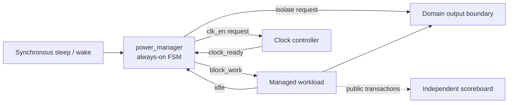
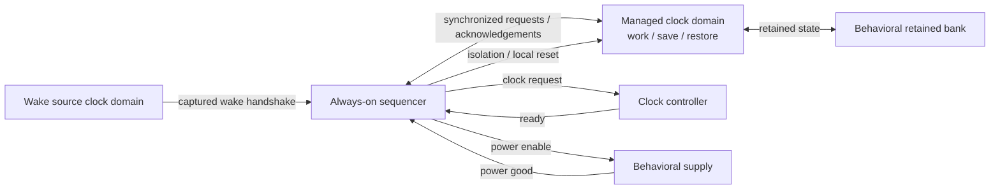
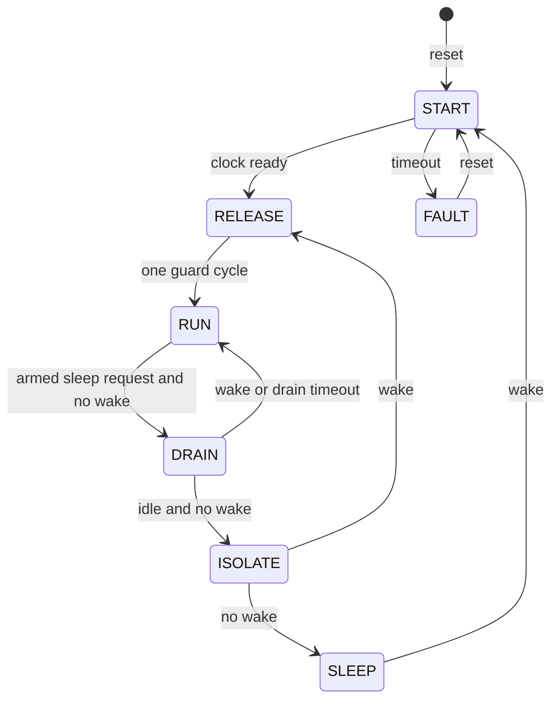

# Architecture

Three configurations share the sequencing rules but have different contracts.
The synchronous core supports clock sleep; the CDC wrapper adds crossings; the
retention controller is a separate sequencer for modeled power gating.

In M2 the worker uses an enable on the always-on clock. M3 uses a separate,
stoppable managed clock. `power_manager_cdc` adds synchronized level handshakes,
wake capture and local reset release around the core. Its admission path blocks
new work while accepted work drains, then returns a quiesce acknowledgement.
Handshake cleanup prevents a stale acknowledgement from satisfying a new request.
See [CDC contracts](m3-cdc.md) for pulse spacing, reset cancellation and latency.

The second diagram describes M4's separate `power_manager_retention` configuration.
It saves state before isolation and power removal, then restores it before work
admission. The retained bank survives an ordinary power cycle; global reset
discards its snapshot. The independent retention scoreboard predicts data from
accepted writes. See [retention contracts](m4-retention.md) for the full state
sequence, failure handling and behavioral model boundaries.

## Synchronous core FSM

Global reset selects START from any state. RUN admits work; DRAIN blocks new work
while the clock stays requested on. ISOLATE clamps outputs for a full cycle before
SLEEP requests clock shutdown. START waits for readiness and RELEASE holds
isolation for one extra cycle before RUN. A drain timeout returns to RUN with a
sticky fault; a start timeout locks in FAULT until reset. Wake beats idle and
timeout in DRAIN, and readiness beats timeout in START.

The physical clock gate, isolation cells, power switch and retention cells are
outside this repository's implementation. Logical requests and behavioral models
do not establish glitch freedom, analog timing, physical CDC safety or power savings.

Next: [annotated waveforms](waveforms.md), [verification matrix](verification-matrix.md).
