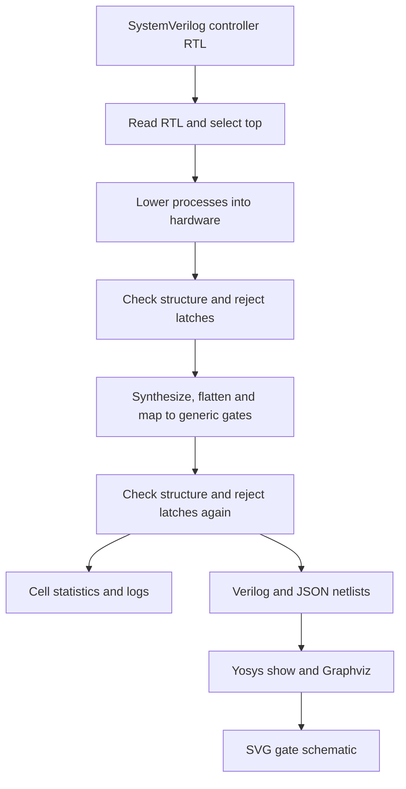

# Showing the project

You can demonstrate the project on your own PC. Simulation generates signal
traces; GTKWave displays them. Yosys converts the RTL into a generic gate netlist;
Graphviz renders a schematic. No FPGA or fabricated chip is needed for this demo.

For a browser-only review, show the [architecture](architecture.md),
[annotated waveforms](waveforms.md), [verification matrix](verification-matrix.md)
and [passing CI run](https://github.com/Sean184344/power-manager/actions/runs/40442477414).
The archived figures are available without installing HDL tools.

## Run on Ubuntu or Ubuntu inside Windows WSL

In an Ubuntu terminal, install the tools once:

```sh
sudo apt-get update
sudo apt-get install -y git make python3 iverilog yosys gtkwave graphviz
git clone https://github.com/Sean184344/power-manager.git
cd power-manager
```

If you already have a normal clone, use its project directory instead of cloning
again. GTKWave needs a graphical desktop; on WSL that requires working Linux GUI
support. The tests and SVG generation can run without a display. A native Windows
or macOS installation needs a tool setup appropriate for that operating system;
the commands above are Ubuntu commands.

## Demonstrate the RTL waveforms

```sh
make test
gtkwave build/power_manager.vcd
```

In GTKWave, select the `tb_power_manager` scope and add `clk`, `state`,
`sleep_req`, `wake`, `idle`, `ready`, `clk_en`, `isolate`, `block_work`, and `fault`
to the waveform pane. Display `state` as an unsigned decimal value:
RUN=0, DRAIN=1, ISOLATE=2, SLEEP=3, START=4, RELEASE=5, FAULT=6.

First zoom to 30–115 ns. Point out isolation at 55 ns, the clock-disable request
at 65 ns, wake at 75 ns, readiness accepted at 95 ns and work reopening at 105 ns.
Then zoom to 675–750 ns to explain the startup timeout and reset-required fault.
The [annotated walkthrough](waveforms.md) explains both windows.

To show actual transaction accounting as well, open the workload test:

```sh
gtkwave build/workload.vcd
```

The baseline controller trace uses directly driven acknowledgements; the workload
test adds a worker and independent scoreboard. Neither trace is a gate-level or
post-layout timing simulation. Save the GTKWave signal arrangement as a `.gtkw`
file through the viewer if you want to reuse your presentation layout.

For portable figures, reproduce the existing SVGs:

```sh
python3 scripts/render_waveforms.py --vcd build/power_manager.vcd --output build/demo
```

Open `build/demo/sleep-wake.svg` and `build/demo/start-timeout.svg` in a browser,
or insert them into slides with the test command and scenario caption.
[GTKWave documentation](https://gtkwave.sourceforge.net/) describes its VCD viewer.

## Show the synthesis flow and result

This diagram describes the implemented synthesis pipeline:



```sh
make schematic
```

This reruns synthesis for all three controllers, then draws the synchronous core.
Open `build/synthesis/power_manager-schematic.svg` in your browser.
An [archived core gate schematic](images/power_manager-synth.svg) is also available.
The final gate schematic is large: use the architecture/FSM diagram for the
overview and zoom into this schematic when discussing implementation details.

Show these files beside the diagram:

| Output | What it establishes |
|---|---|
| `build/synthesis/results.json` | Tool version, source hashes, cell counts and structural-check results |
| `build/synthesis/power_manager.log` | Complete core synthesis log |
| `build/synthesis/power_manager.netlist.v` | Generated generic gate-level Verilog |
| `build/synthesis/power_manager.netlist.json` | Machine-readable netlist used to draw the schematic |

The recorded Yosys 0.33 counts are 116 / 186 / 577 generic cells for the core,
CDC and retention tops, each with zero latches. Other tool versions may produce
different counts. This schematic is a generic synthesized circuit; there is no
placed-and-routed chip layout, technology-specific area, timing closure or measured
power result. See [synthesis scope](m5-formal-synthesis.md).

## A short presentation sequence

1. Explain the shutdown/wake problem using the architecture and FSM diagram.
2. Show the normal waveform, then the startup-timeout waveform and fault policy.
3. Run `make check` and show the coverage matrix and expected mutation detections.
4. Show the synthesis flow, cell-count report and a zoomed part of the core schematic.
5. Link the GitHub CI run so reviewers can inspect independent replay evidence.

For a recorded demo, keep the terminal command, PASS summary, waveform signal
names, time axis and your explanation visible. Reviewers can reproduce the same
result from the repository.
