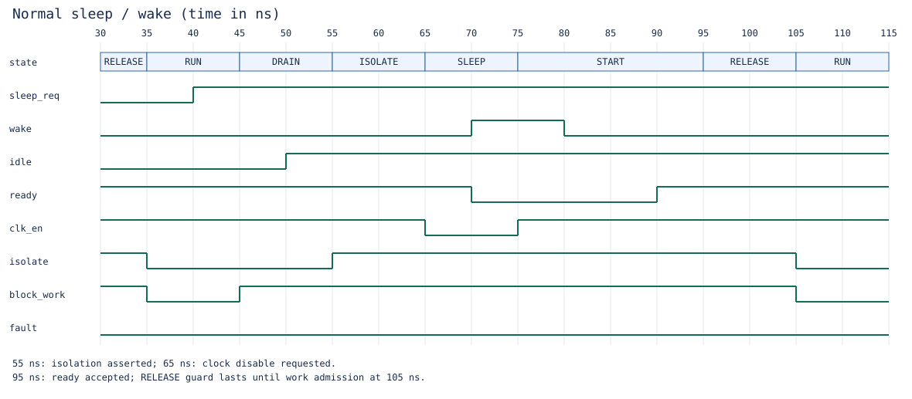
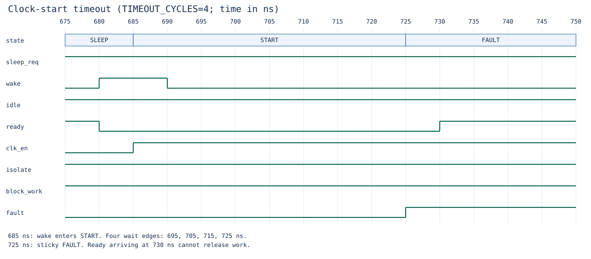

# Annotated simulation waveforms

These diagrams plot actual signal changes from the baseline Icarus simulation,
with `TIMEOUT_CYCLES=4`. Time is in ns; the captured VCD uses a 1 ps timescale.
`clk_en` is a logical clock request. It is not a trace of the managed clock.

## Normal sleep and wake



| Time | Observation |
|---|---|
| 35 ns | RUN opens admission after reset startup. |
| 45 ns | Sleep request selects DRAIN and blocks new work. |
| 55 ns | Idle acknowledgement selects ISOLATE; clock remains requested on. |
| 65 ns | SLEEP requests the clock off after a full isolation cycle. |
| 75 ns | Wake selects START and requests the clock on. Readiness is still low. |
| 95 ns | Readiness selects RELEASE, keeping work blocked and isolation asserted. |
| 105 ns | RUN opens admission. The held sleep request does not retrigger entry. |

## Clock startup failure



START begins at 685 ns. The four unsuccessful wait edges are 695, 705, 715 and
725 ns. On the fourth edge FAULT asserts and locks the state machine. Readiness
arriving at 730 ns cannot clear the fault. Work stays blocked, isolation stays
asserted and the clock remains requested on. Reset is required to recover.
This differs from a drain timeout, which returns to RUN with a sticky fault
because the clock was never stopped.

## Inspect and reproduce

The complete [baseline VCD](../reports/m6/baseline.vcd) includes all 16 scenarios.
Open it in a VCD viewer and select `tb_power_manager.state`, `sleep_req`, `wake`,
`idle`, `ready`, `clk_en`, `isolate`, `block_work` and `fault`.
State encodings are RUN=0, DRAIN=1, ISOLATE=2, SLEEP=3, START=4, RELEASE=5, FAULT=6.
The [capture manifest](../reports/m6/waveforms.json) records source and VCD hashes.

```sh
make test
python3 scripts/render_waveforms.py --vcd build/power_manager.vcd --output build/waveform-review
```

The standard-library renderer reads signal changes from the VCD; it does not
simulate the FSM or invent expected values. Its selected time windows correspond
to this baseline testbench. If stimulus timing changes, review the windows and
annotations before replacing the archived illustrations.
